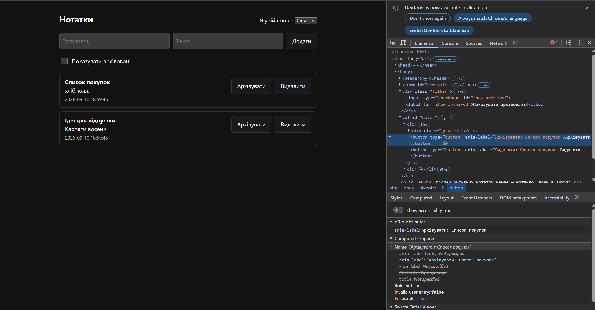
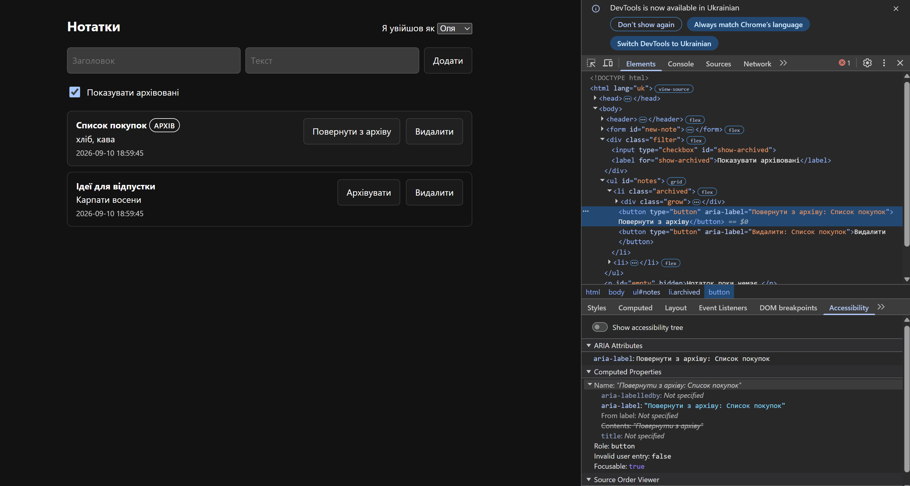
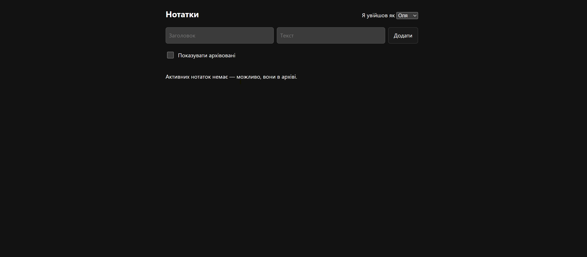
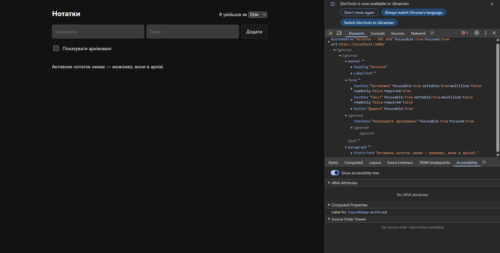

# Task A — перевірка UI в браузері

Фіча: архівування нотатки в інтерфейсі. Перевірено вручну в Chrome на
`http://localhost:3080`, користувач **Оля (id 1)**. Нижче — що саме дивилися і
що показав браузер, а не переказ «працює».

## Що додано в UI

| Елемент | Файл |
|---|---|
| Кнопка «Архівувати» / «Повернути з архіву» на кожній нотатці | `app/public/app.js` |
| Чекбокс «Показувати архівовані» | `app/public/index.html` |
| Бейдж **АРХІВ** + приглушений фон архівної нотатки | `app/public/app.js`, `app/public/style.css` |
| Окремий порожній стан для активного списку | `app/public/app.js` |

## 1. Активний список — кнопка на місці



Видно у DOM:

```html
<div class="filter">
  <input type="checkbox" id="show-archived">
  <label for="show-archived">Показувати архівовані</label>
</div>
```

`for` збігається з `id` — текст лейбла є частиною контрола, клік по ньому
перемикає чекбокс.

Панель **Accessibility** для кнопки архівування:

- `Name: "Архівувати: Список покупок"`
- `Role: button`
- `Focusable: true`

Імʼя містить заголовок нотатки — у скрінрідері не буде списку однакових
«Архівувати» без контексту.

## 2. Стан архіву видно в інтерфейсі



Після кліку «Архівувати» нотатка зникає з активного списку. З увімкненим
чекбоксом вона повертається і відрізняється **трьома** сигналами одразу:

- `<li class="archived">` — приглушений фон;
- бейдж **АРХІВ** — текстом, не лише кольором;
- кнопка перемкнулась на «Повернути з архіву», і `Name` у дереві доступності
  теж став `"Повернути з архіву: Список покупок"`.

Стан не передається самим лише кольором — вимога контрасту не стає єдиним
носієм інформації.

## 3. Порожній стан



Коли всі нотатки в архіві, активний список показує:

> Активних нотаток немає — можливо, вони в архіві.

Текст залежить від фільтра: з увімкненим чекбоксом (коли порожньо взагалі)
показується нейтральне «Нотаток поки немає.». Користувач не лишається в
глухому куті — поруч видно чекбокс, яким їх дістати.

## 4. Дерево доступності



`Show accessibility tree` увімкнено. Ключове:

```text
checkbox "Показувати архівовані" focusable: true focused: true
...
Label for input#show-archived
```

- чекбокс **отримав імʼя з `<label>`** — Chrome підтверджує звʼязок рядком
  `Label for input#show-archived`;
- `focused: true` — до контрола дійшли **клавіатурою (Tab)**, не мишею;
- структура сторінки читається семантично: `banner` → `heading "Нотатки"` →
  `form` → `list` → `paragraph`.

## Доступність — що зроблено свідомо

- Справжні `<button type="button">` з видимим текстом, а не `<div>` з
  `onclick`: працюють з клавіатури і по Enter/Space без додаткового коду.
- `aria-label` з назвою нотатки на кожній кнопці — інакше скрінрідер читає
  ряд однакових «Архівувати».
- `min-height: 44px; min-width: 44px` на кнопках — розмір цілі. Обов'язковий
  мінімум за WCAG 2.2 SC 2.5.8 (Target Size Minimum, рівень AA) — **24×24**
  CSS-пікселі, ще й з винятками (достатній інтервал між цілями, ціль усередині
  рядка тексту, наявність еквівалентної дії поруч). 44×44 — це вже
  SC 2.5.5 (Target Size Enhanced, рівень **AAA**); узяли його як проєктну
  ціль, бо запас тут дешевий, а не тому, що AA цього вимагає.
- `:focus-visible` з `outline: 2px solid currentcolor` — фокус видно завжди;
  дефолтний контур легко губиться на темному тлі.
- Стан архіву дублюється текстом (бейдж), а не лише фоном.

## Консоль браузера

У консолі під час перевірки була рівно одна помилка:

```text
Failed to load resource: the server responded with a status of 404 (Not Found)
```

Перевірили, що це: запит `GET /favicon.ico` → 404. У `app/public/` лежать лише
`index.html`, `app.js` і `style.css` — іконки в засіяному репозиторії немає, а
браузер просить її сам. **До нашого коду це не стосується**: жоден `fetch` до
`/api/notes` не впав, інакше список не відмалювався б.

Свідомо не чинили: додавання фавікона — зміна поза скоупом завдання, а
реальної шкоди немає. Зафіксували як перевірене, а не як полагоджене.

## Чого ця перевірка не покрила

Перевірка тут ручна: DOM, дерево доступності, прохід Tab-ом. Контраст на
цьому етапі оцінювали на око.

**Око помилилось.** У Task E ми прогнали Lighthouse, і він знайшов дві речі,
яких ця сторінка не побачила:

- **контраст меж кнопок** — 1.48:1 при нормі 3:1 (текст читався добре, тому
  дефект не впадав у вічі);
- **відсутній `<main>`** — не було орієнтира для скрінрідера.

Обидві виправлено, повторний прогін — 100/100. Деталі:
`docs/task-e-bonus.md`.

Зворотне теж правда: Lighthouse не перевіряє того, що перевірено вище —
чи `aria-label` **осмислені**, чи логічний порядок фокусу, чи зрозумілий
порожній стан. Він сам перелічує 10 таких пунктів як «manually check».
Дві перевірки доповнюють одна одну, жодна не замінює іншу.
