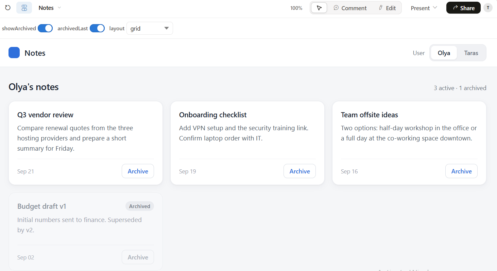

# Task E (bonus) 

## Шлях 1 — зовнішній генератор UI

**Інструмент:** Claude Design
**Що просив:** "Design a minimalist notes management interface for a web app with the following behavior:

Top bar with title “Notes”
User selector with two options: Olya and Taras
Notes displayed as cards
Each card includes note title, content, and an Archive button
Archived notes appear with a muted grey style and a label “Archived”
Layout is clean, modern, white/gray palette, soft shadows, 12px–16px rounded corners
Buttons in blue/gray accents with subtle hover effects
Use a professional but simple productivity app aesthetic
Desktop-first but responsive for smaller screens
No complex animations, only subtle transitions
This should resemble a simple full-stack app UI that works with a backend API
The design should feel like a real internal business app, not a mockup with unrealistic gradients or oversized elements.

Output only the final UI."

**Що вийшло:** 

**Що довелося б змінити, перш ніж це потрапило б у цей репозиторій:**

| Аспект | Згенероване | Що треба тут |
|---|---|---|
| Стек / збірка | Це прев'ю в самому дизайн-інструменті (панель "Comment / Edit / Present / Share", тумблери `showArchived`, `archivedLast` і дропдаун `layout: grid` — це варіанти компонента на канвасі, не UI застосунку). Судячи з таких пропів-перемикачів — компонентний фреймворк з build-кроком (React/подібне), токени дизайну, іконки, шрифти з окремого пакету. | Ніякого фреймворка й збірки: чистий `app/public/index.html` + `app.js` (ES-модуль) + `style.css`. Довелось би переписати компонент у `document.createElement`, як у наявному `app.js`, а не портувати JSX/пропи. |
| Розмітка й доступність | Кнопка на архівній картці підписана так само "Archive", як і на активній — немає видимого "Unarchive"/"Restore" для протилежної дії, тобто напис не змінюється разом зі станом. Стан "Archived" передається лише сірим кольором тексту + бейджем — колір сірого на світло-сірому фоні картки на вигляд не дає впевненого 4.5:1. Немає підпису, до якої саме нотатки належить кнопка (просто "Archive" без імені) — для скрінрідера всі кнопки звучать однаково. Невідомо навіть, чи це `<button>`, а не стилізований `
` — дизайн-інструмент цього не гарантує. | Тут навпаки: текст кнопки явно змінюється (`Архівувати` ⇄ `Повернути з архіву`), кожна має `aria-label` з назвою нотатки (`Архівувати нотатку «Список покупок»`), реальний `<button>`, контраст і мінімальний розмір цілі. Довелося б переробити майже всю семантику кнопок і додати перевірку контрасту заново. |
| Як воно ходить по дані | Нічого нікуди не ходить: "3 active · 1 archived" і список карток — статичний mock, перемикання станів робиться пропами компонента на канвасі (`showArchived`/`archivedLast`), а не реальним запитом. Немає станів завантаження/помилки, немає уявлення про те, що дані взагалі можуть не прийти. | Кожна дія — реальний `fetch` на Express-ендпоінт (`GET /api/notes?archived=`, `PATCH /api/notes/:id/archive`) з обов'язковим `x-user-id` у заголовку; список і лічильники завжди похідні від відповіді сервера, а не від локального прапорця UI. Довелось би написати весь шар роботи з мережею з нуля — дизайн цього питання просто не торкається. |

**Висновок:** корисний як мудборд для розкладки картки (заголовок / текст / дата / кнопка знизу, відступи, заокруглення) — це можна взяти як референс для `style.css`.

