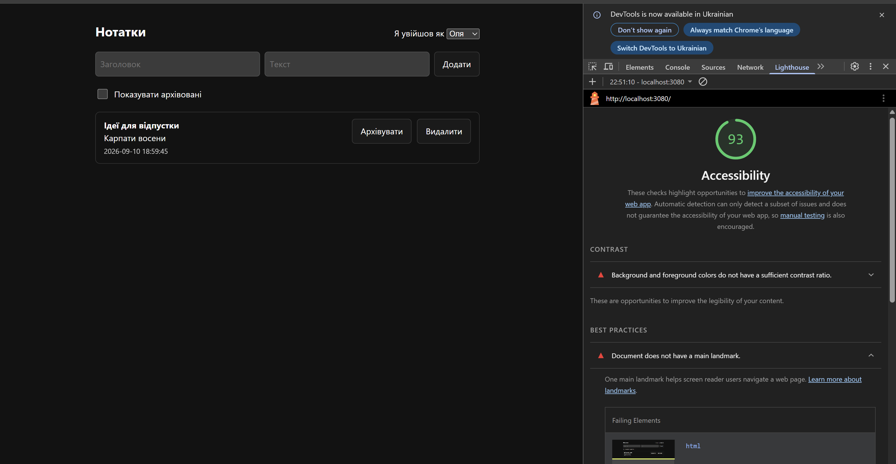
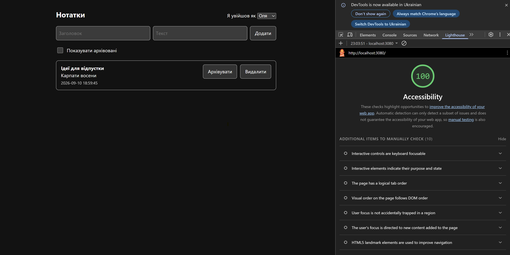

# Task E (bonus) — Шлях 2: автоматична перевірка доступності

Інструмент: **Lighthouse**, вбудований у Chrome DevTools (категорія
Accessibility, режим Navigation, Desktop). Обрано свідомо: він уже є в
браузері, тож **жодної нової залежності в `package.json`** — правила репо
просять не додавати залежностей без потреби.

Сторінка: `http://localhost:3080`, застосунок запущено через `npm run dev`.

---

## Результат: 93 → 100

| | До | Після |
|---|---|---|
| Оцінка | **93** | **100** |
| Знайдено проблем | 2 | 0 |





---

## Що знайшов інструмент

### 1. Контраст меж контролів (WCAG 1.4.11)

> **CONTRAST** — Background and foreground colors do not have a sufficient
> contrast ratio.
> Failing Elements: `button`, `button`, `button`

Три кнопки: «Додати», «Архівувати», «Видалити».

**Спершу я поставив хибний діагноз.** Побачивши «CONTRAST», припустив, що
винен `li small { opacity: .75 }` — тьмяна дата під нотаткою. Порахував:
8.66:1 у темній темі, 8.59:1 у світлій — проходить із запасом. Друга
гіпотеза, плейсхолдери полів (3.29:1) — теж мимо. Обидві були правдоподібні й
обидві хибні; допоміг лише **точний список Failing Elements** зі звіту.

Справжня причина — успадковані із засіяного CSS напівпрозорі кольори:

```css
button { border: 1px solid #8884; background: #8881; }
```

`#8881` — це `#888` з альфою ≈7%. Порахувавши **те, на що справді вказав
інструмент**:

| Що | Було | Треба |
|---|---|---|
| заливка кнопки проти фону сторінки | **1.08:1** | — |
| **рамка кнопки** проти фону сторінки | **1.48:1** | **3:1** |
| текст на кнопці | 12.95:1 | 4.5:1 ✅ |

Текст читався чудово — а от **межа кнопки була практично невидима**. Видно
напис, не видно, що це кнопка. Саме про це WCAG 1.4.11 (non-text contrast):
вимога стосується контуру компонента, а не його заливки.

**Виправлення** — `app/public/style.css`, кольори винесено в змінні:

```css
:root {
  --edge:    light-dark(#767676, #9a9a9a);  /* межі контролів */
  --surface: light-dark(#ececec, #333333);  /* заливка       */
}
```

`light-dark()` дає одне значення на роль замість media-query на кожне
правило. Застосовано до кнопок, полів вводу, карток нотаток і фону архівної
картки.

Після правки (порахунок для обох тем):

| Перевірка | Темна | Світла | Поріг |
|---|---|---|---|
| межа кнопки / поля / картки проти фону | 6.06:1 | 4.54:1 | 3:1 |
| текст кнопки на заливці | 10.41:1 | 16.11:1 | 4.5:1 |
| текст на архівній картці | 12.46:1 | 16.70:1 | 4.5:1 |

### 2. Немає орієнтира `<main>` (best practice)

> **BEST PRACTICES** — Document does not have a main landmark.
> Failing Elements: `html`

Користувач скрінрідера не мав змоги перестрибнути шапку й форму до основного
вмісту. Виправлено в `app/public/index.html`: форму, фільтр і список нотаток
обгорнуто в `<main>`.

---

## Головний висновок: 100 ≠ «доступно»

Найцінніше у звіті — не оцінка, а розділ, який зʼявився після виправлень:

> **ADDITIONAL ITEMS TO MANUALLY CHECK (10)**
> Interactive controls are keyboard focusable · Interactive elements indicate
> their purpose and state · The page has a logical tab order · Visual order on
> the page follows DOM order · User focus is not accidentally trapped in a
> region · The user's focus is directed to new content added to the page ·
> HTML5 landmark elements are used to improve navigation · …

Інструмент прямо каже, що **десять речей він не перевіряє** — і це саме те,
що я перевіряв руками в Task A. Lighthouse і сам про це попереджає у власному
описі: *«Automatic detection can only detect a subset of issues and does not
guarantee the accessibility of your web app»*.

### Хто що знайшов

| | Знайшла | Пропустила |
|---|---|---|
| **Ручна перевірка** (Task A: DOM, дерево доступності, Tab) | осмислені `aria-label` з назвою нотатки, зв'язок `label↔input`, розмір цілі 44px, стан архіву не лише кольором | контраст меж кнопок, відсутній `<main>` |
| **Lighthouse** | контраст меж кнопок, відсутній `<main>` | чи `aria-label` осмислені (порожній рядок теж «пройшов би»), чи логічний порядок фокусу, чи зрозумілий порожній стан |

Жодна з двох перевірок не покриває іншу. Автоматика ловить те, що
вимірюється числом; людина — те, що вимагає розуміння змісту.

### Ще два спостереження

**Дефект приїхав із засіяного репо.** `#8884` / `#8881` я не писав — вони
були в стартовому CSS. Я додав до кнопок `min-height: 44px` і
`:focus-visible`, тобто **редагував саме ці правила** — і не перевірив те, що
успадкував. Зручна ілюзія: «цей код був тут до мене, отже з ним усе гаразд».

**Оцінка 93 виглядала майже ідеальною.** На сторінці з чотирма контролами дві
реальні проблеми дали лише -7 балів. Якби я подивився на цифру й заспокоївся,
обидві доїхали б до PR. Корисний тут не бал, а **список Failing Elements** —
саме він, а не мої дві правдоподібні гіпотези, вказав на справжню причину.

---

## Відтворити

```bash
cd app && npm run dev          # http://localhost:3080
```

Chrome → F12 → вкладка **Lighthouse** → Categories: лише **Accessibility** →
Mode: **Navigation** → Device: **Desktop** → **Analyze page load**.

Тестів це не змінює: `npm test` — 37/37 зелених до і після.
